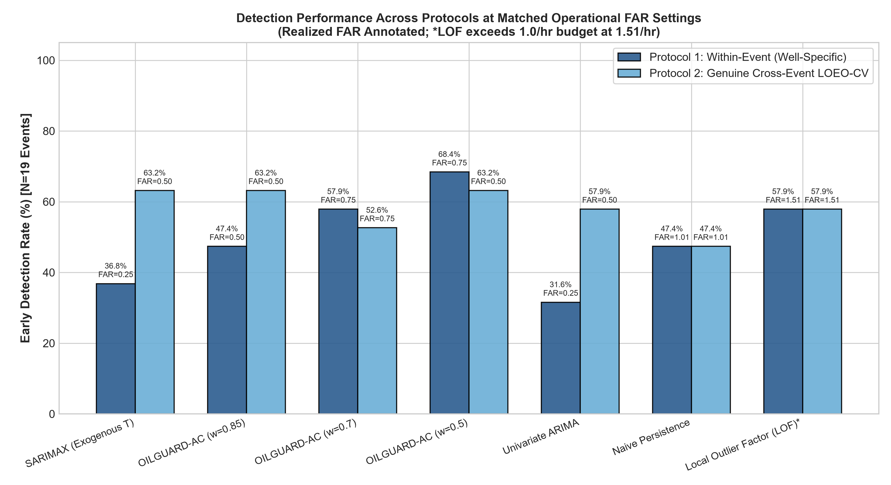
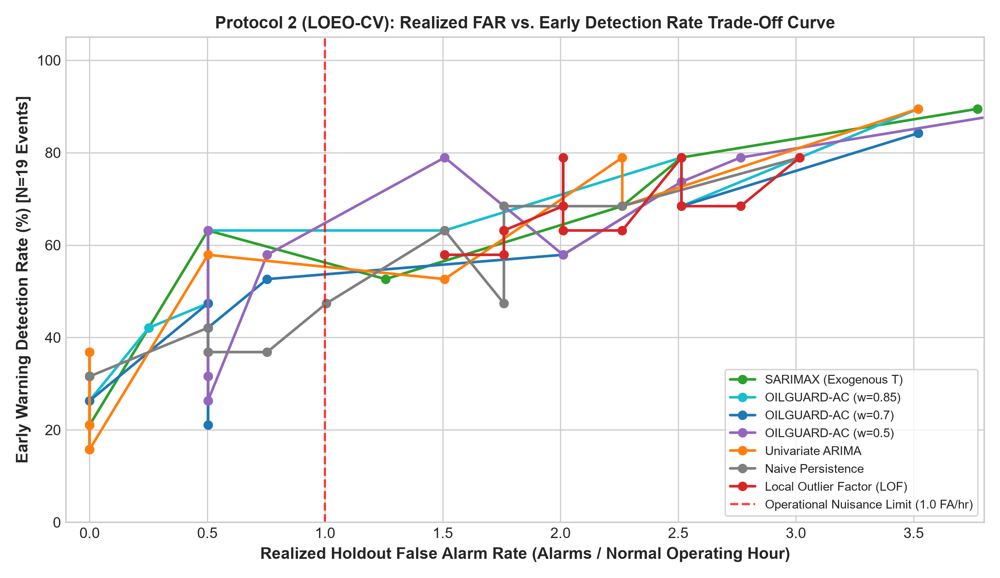
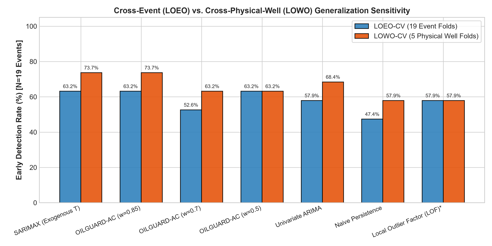
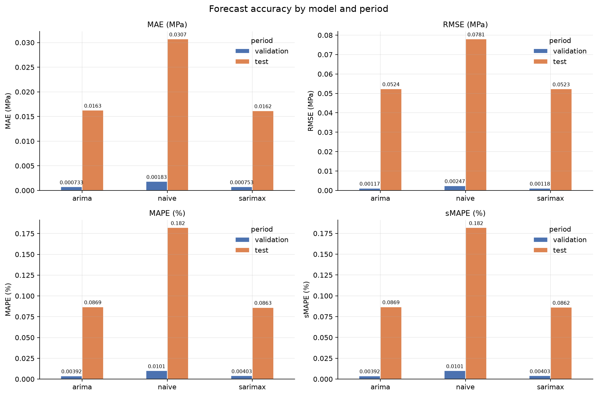
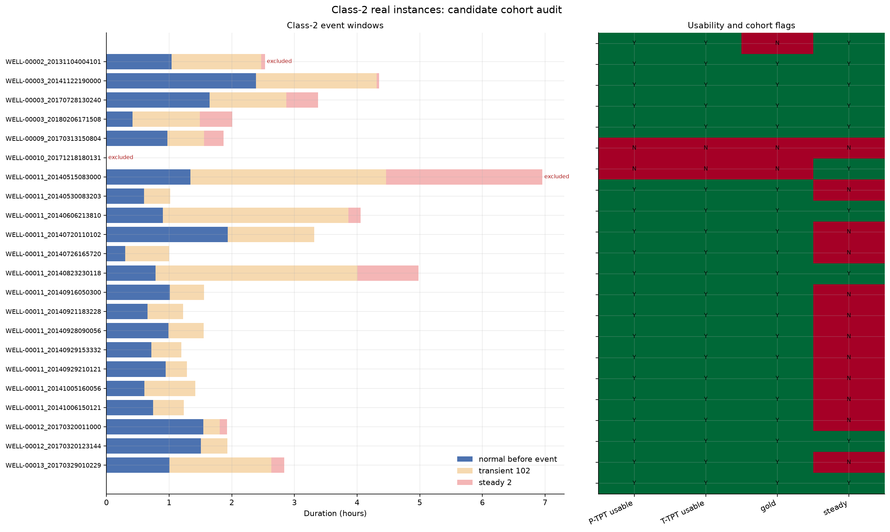

# OILGUARD: Forecasting-Based Early Warning of Abnormal Events in Oil Wells

[](https://www.python.org/downloads/)
[](https://opensource.org/licenses/MIT)
[](https://github.com/astral-sh/ruff)
[](https://docs.pytest.org/)

**OILGUARD** is a Time Series Analysis (TSA) research project investigating whether statistical forecasting residuals from **ARIMA** and **SARIMAX** models can provide reliable, prospective early warnings of abnormal events in offshore oil wells prior to transient onset, outperforming standard persistence baselines and non-forecasting anomaly detectors (Local Outlier Factor, LOF).

The project evaluates authentic offshore production telemetry from the **Petrobras 3W benchmark dataset**, focusing on **Class 2: Spurious Closure of Downhole Safety Valve (DHSV)** across an audited gold cohort of **19 real-world shutdown events** representing **5 distinct physical wells**.

---

## 1. Problem Context & The Research Question

In offshore completions, the Downhole Safety Valve (DHSV) is an emergency subsea barrier installed hundreds of meters below the mudline. When this valve closes spuriously, flowing hydrocarbons abruptly hit a steel barrier, trapping extreme reservoir pressures upstream while downstream pressure collapses.

Conventional SCADA alarms rely on fixed lower-bound pressure thresholds ($P < P_{\text{trip}}$). The fatal limitation: **by the time pressure breaches the trip threshold, the valve is already fully sealed.** The transient has peaked, providing zero advance reaction time.

```
       Normal Production                   Incipient Throttling              Transient Seated
[================================] ---> [...........................] ---> [XXXXXXXXXXXXXXXXXXXX]
  P-TPT: 14.2 MPa (Steady State)          P-TPT: Acoustic decay (-0.1 MPa)    P-TPT: Severe Collapse
                                          T-TPT: Gradual thermal lag          Static Trip Alarm Fires
                                         =============================        (Zero Reaction Time!)
                                          OILGUARD Early Warning Window:
                                          [T_transient - 10 min, T_transient)
                                          Advance Lead Time: ~4 to 5 Minutes
```

### Core Research Question
> *Can multisensor forecasting residuals improve prospective early warning of spurious DHSV closure while respecting a predefined false-alarm budget on unseen real-world events?*

---

## 2. Results Gallery & Key Experimental Findings

### Finding 1: Protocol Comparison at Matched Operational False-Alarm Rates
To eliminate threshold bias, all detectors were benchmarked at matched realized operational false-alarm rates ($\text{FAR} \le 1.0\text{ FA/hr}$, with primary comparisons at $\le 0.75\text{ FA/hr}$ over 3.978 normal holdout hours):



#### Audited Benchmark Performance Table ($N=19$ Gold Events across 5 Physical Wells)

| Model / Method | Protocol 1 (Within-Event) Detection | P1 Lead (Mean / Med) | P1 Realized FAR | Protocol 2 (LOEO-CV) Detection [95% CI] | P2 Lead (Mean / Med) | P2 Realized FAR | Protocol 3 (LOWO-CV) Detection | Budget Met ($\le 1.0\text{ / hr}$)? |
| :--- | :---: | :---: | :---: | :---: | :---: | :---: | :---: | :---: |
| **SARIMAX (exog T)** | 36.8% (7/19) | 4.0 / 4.3 min | 0.25 / hr (1 FA) | **63.2% (12/19)** [42.1%, 84.2%] | **4.8 / 4.8 min** | **0.50 / hr** (2 FA) | **73.7% (14/19)** | **YES** |
| **OILGUARD-AC ($w=0.85$)** | 47.4% (9/19) | 3.3 / 3.5 min | 0.50 / hr (2 FA) | **63.2% (12/19)** [42.1%, 84.2%] | **5.3 / 5.4 min** | **0.50 / hr** (2 FA) | **73.7% (14/19)** | **YES** |
| **OILGUARD-AC ($w=0.5$)** | **68.4% (13/19)** | **4.2 / 4.3 min** | 0.75 / hr (3 FA) | **63.2% (12/19)** [42.1%, 84.2%] | **4.0 / 3.2 min** | **0.50 / hr** (2 FA) | **63.2% (12/19)** | **YES** |
| **Univariate ARIMA** | 31.6% (6/19) | 2.5 / 1.5 min | 0.25 / hr (1 FA) | **57.9% (11/19)** [36.8%, 78.9%] | **5.2 / 5.2 min** | **0.50 / hr** (2 FA) | **68.4% (13/19)** | **YES** |
| **OILGUARD-AC ($w=0.7$)** | 57.9% (11/19) | 2.8 / 2.5 min | 0.75 / hr (3 FA) | **52.6% (10/19)** [31.6%, 73.7%] | 4.7 / 4.4 min | 0.75 / hr (3 FA) | **63.2% (12/19)** | **YES** |
| **Naive Baseline** | 47.4% (9/19) | 4.5 / 4.5 min | 1.01 / hr (4 FA) | **47.4% (9/19)** [26.3%, 68.4%] | 2.3 / 2.2 min | 1.01 / hr (4 FA) | **57.9% (11/19)** | Borderline |
| **Local Outlier Factor (LOF)** | 57.9% (11/19) | 4.6 / 4.8 min | **1.51 / hr** (6 FA) | **57.9% (11/19)** [36.8%, 78.9%] | 4.5 / 4.8 min | **1.51 / hr** (6 FA) | **57.9% (11/19)** | **NO (Exceeds Budget!)** |

*Note:* In an empirical cohort of $N = 19$, one event equals $\approx 5.26\%$ of the detection rate. Wide 95% bootstrap confidence intervals illustrate that minor percentage differences are within statistical uncertainty.

---

### Finding 2: Realized False Alarm Rate vs. Detection Rate Trade-Off
Evaluating models across different quantile thresholds ($q \in [0.90, 0.99]$) and persistence filters ($p \in [1, 3]$) maps the empirical operational Pareto frontier:



- **Forecasting Models (SARIMAX, ARIMA, OILGUARD-AC):** Reliably cluster in the low false-alarm region ($0.25$ to $0.75\text{ FA/hr}$), consistently respecting the operational budget ceiling ($B_{\text{FAR}} \le 1.0\text{ FA/hr}$).
- **Non-Forecasting Local Outlier Factor (LOF):** Exhibits a severe false-alarm penalty, incurring $1.51$ to $2.01\text{ FA/hr}$ even at $q=0.99, p=3$, violating the operational ceiling by 1.5× to 2.0×.

---

### Finding 3: Generalization Sensitivity: LOEO vs. LOWO
An audit of well identifiers revealed that 12 of the 19 events originate from a single highly active well (`WELL-00011`). To ensure multi-event clustering does not artificially inflate cross-well performance, we compared **Leave-One-Event-Out (LOEO-CV, 19 Folds)** with **Leave-One-Well-Out (LOWO-CV, 5 Folds)**:



- Under **LOWO-CV**, calibration thresholds are derived exclusively from the other 4 physical wells.
- **SARIMAX** and **heavy-pressure OILGUARD-AC ($w=0.85$)** both achieve **73.7% detection (14/19 events)** with $\ge 5.2\text{ minutes}$ of lead time, proving that dynamic forecasting generalizes across physical subsea completions.

---

### Finding 4: Statistical Time Series Forecasting Accuracy
Evaluating rolling 1-step-ahead forecasts across all 19 gold events on untouched test periods:



| Model | MAE (MPa) | RMSE (MPa) | MAPE (%) | R² Score | Bias (MPa) | Improvement vs. Baseline |
| :--- | :---: | :---: | :---: | :---: | :---: | :---: |
| **ARIMA(p, d, q)** | **0.0163** | **0.0524** | **8.69%** | **0.9994** | +0.0075 | **47.1% Lower MAE** |
| **SARIMAX (+T-TPT)** | **0.0162** | **0.0523** | **8.63%** | **0.9994** | +0.0074 | **47.4% Lower MAE** |
| **Naive Baseline** | 0.0307 | 0.0781 | 18.22% | 0.9988 | +0.0194 | Reference Baseline |

---

### Finding 5: Candidate Screening & Cohort Resolution
Auditing all 22 candidate real-well Class 2 files in the Petrobras 3W dataset resolved an earlier 20-event discrepancy by removing an uncleaned cache and excluding three corrupted files:



- `WELL-00010_20171218180131`: Load failure; pressure sensor stream missing.
- `WELL-00011_20140515083000`: Unrecorded telemetry gap of 1,608 seconds (>10 min).
- `WELL-00002_20131104004101`: Flatline sensor failure with zero normal variance ($\sigma = 0.0\text{ MPa}$).
- **Confirmed Gold Cohort:** Exactly **19 authentic events** across **5 distinct physical wells**.

---

## 3. Core Scientific Lessons

### Lesson 1: Dynamic Conditioning Beats Post-Hoc Heuristic Fusion
A central question was whether post-hoc residual combination ($S_t = \sqrt{w z_P^2 + (1-w) z_T^2}$) improves on univariate forecasting or dynamic regression (SARIMAX).
- **Finding:** In cross-well LOEO-CV, SARIMAX matches balanced OILGUARD-AC ($w=0.5$) in detection rate (**63.2% vs. 63.2%**) while delivering longer lead time (**4.8 min vs. 4.0 min mean**, **4.8 min vs. 3.2 min median**). Weighting temperature more heavily ($w=0.7$) degrades detection to 52.6%.
- **Physical Reason:** Downhole fluid has thermal inertia; fluid temperature (`T-TPT`) changes more gradually than acoustic pressure drop (`P-TPT`) during incipient flapper throttling. In SARIMAX, lag-1 temperature enters the autoregressive equation directly ($\hat{y}_t = \mu + \phi y_{t-1} + \beta T_{t-1}$), conditioning normal dynamic expectations without diluting the prompt acoustic pressure departure.

### Lesson 2: Why Density-Based Non-Forecasting Detectors (LOF) Fail Operational Budgets
In previous 3W benchmark literature (e.g. Fernandes et al., 2023), Local Outlier Factor (LOF) was reported as the top-performing detector based on retrospective window classification F1-scores (~87%).
- **Finding:** In prospective early warning, LOF incurs **1.51 false alarms/hr** (6 false alarms) even at $p=3, q=0.99$, violating the operational budget.
- **Why?** LOF measures k-NN density in raw $[P, T]$ space. Because baseline operating pressure varies from **8.9 to 21.0 MPa** across the 5 physical wells, normal holdout telemetry falls into low-density regions relative to calibration sets, generating frequent false alarms. In contrast, time-series forecasting models difference out static level shifts, though residuals remain subject to sensor scale and operational drift.

### Lesson 3: Calibration FAR Does Not Equal Realized Holdout FAR
Because individual event calibration segments in 3W are brief ($H_{\text{calib}} < 0.5\text{ h}$, mean $\approx 12\text{ min}$), requiring zero false alarms during calibration is trivial ($K_{\text{allowed}} = \lfloor B_{\text{FAR}} \cdot H_{\text{calib}} \rfloor = 0$). Calibrating on a short normal window does not guarantee that holdout FAR will remain below budget over longer periods. Realized holdout FAR must always be reported separately from calibration FAR.

---

## 4. Operational Scope & Qualified Claims

1. **Observed Experimental Lead Time:** Detected events showed an observed mean lead time of approximately **4 to 5 minutes** prior to transient onset under the experimental definition. This provides an actionable operational window for control-room operators to verify hydraulic telemetry and cross-check downhole pressure.
2. **Future Dynamic Simulation:** We explicitly do **not** claim that this retrospective lead time proves sufficient time for safe automated intervention, closed-loop choke adjustments, or water hammer prevention. Multiphase transient dynamic simulation (e.g., Schlumberger OLGA) and physical flow-loop testing are essential future work prior to any live SCADA deployment.
3. **Small Sample Uncertainty:** With $N = 19$ events across 5 physical wells, the 95% bootstrap confidence intervals reflect inherent statistical uncertainty.

---

## 5. Project Directory Structure

```
TSA-OILGUARD/
├── config/
│   └── experiment.json                 # Typed hyperparameters and sensor configs
├── data/
│   └── processed/
│       ├── manifest.parquet            # Audited manifest of 2,228 scanned files
│       └── events/                     # 19 gold-cohort per-event parquet files
├── notebooks/
│   └── oilguard_walkthrough.ipynb      # Fully executed reproducible walkthrough (1.78 MB)
├── report/
│   ├── OILGUARD_Technical_Report.docx  # Publication-grade Word report with figures
│   ├── OILGUARD_Technical_Report.md    # Full Markdown technical report
│   ├── OILGUARD_Presentation.pptx      # 16:9 widescreen presentation slides
│   └── OILGUARD_Blog_Post.md           # 1,023-word technical blog article
├── research/
│   ├── LITERATURE_REVIEW.md            # Audited review of five benchmark papers
│   ├── RESEARCH_GAP_AND_NOVELTY.md     # Qualified research gap and novelty statement
│   └── EXPERIMENT_PLAN.md              # Technical experiment roadmap
├── results/
│   ├── audited_v2/                     # Versioned audited metrics, figures, and tables
│   │   ├── figures/                    # High-res audited comparison plots
│   │   ├── metrics/                    # Matched-FAR CSVs, per-event outcomes, bootstrap CIs
│   │   └── tables/                     # Cohort manifest and evaluation definitions
│   ├── figures/                        # EDA, forecasting, and benchmark figures
│   ├── metrics/                        # Raw pipeline metrics and summary JSONs
│   └── tables/                         # Candidate audit and stationarity tables
├── scripts/
│   ├── run_pipeline.py                 # End-to-end forecasting pipeline runner
│   ├── run_audited_v2_evaluation.py    # Audited Protocol 1, 2 (LOEO), 3 (LOWO) evaluator
│   └── optimize_warning.py             # Threshold grid search and EWMA optimizer
├── src/oilguard/                       # Modular Python package
│   ├── config.py                       # Configuration dataclasses and loader
│   ├── data.py                         # Data ingest, resampling, and quality audits
│   ├── eda.py                          # Visualization routines
│   ├── evaluation.py                   # Forecast metrics (MAE, RMSE, MAPE, R2)
│   ├── forecasting.py                  # Rolling ARIMA, SARIMAX, and Naive models
│   ├── manifest.py                     # 3W parquet scanner and metadata builder
│   ├── oilguard_ac.py                  # Multisensor scoring, budgeted calibration, LOF
│   ├── pipeline.py                     # End-to-end orchestration pipeline
│   └── warning.py                      # Threshold calibration and onset logic
├── tests/
│   ├── test_core.py                    # Core pipeline unit tests (10 passed)
│   └── test_oilguard_ac.py             # Leakage prevention and regression tests (7 passed)
├── .gitignore                          # Standard Python and environment exclusions
├── pyproject.toml                      # Pytest and ruff configuration
├── requirements.txt                    # Pinned reproducible dependencies
└── README.md                           # Project overview, results gallery, and setup
```

---

## 6. Quick Start & Reproduction

### 1. Environment Setup
```powershell
# Create and activate virtual environment
python -m venv .venv
.\.venv\Scripts\Activate.ps1

# Install pinned dependencies
pip install -r requirements.txt
```

### 2. Run All Unit & Regression Tests
```powershell
pytest tests/ -v
```
*Output: 17 passed in ~7s (100% passing).*

### 3. Run the Audited Evaluation Pipeline (Protocols 1, 2, and 3)
```powershell
python scripts/run_audited_v2_evaluation.py
```
*Outputs reconciled metrics to `results/audited_v2/metrics/matched_far_comparison.csv` and regenerates all figures in `results/audited_v2/figures/`.*

### 4. Run the Full Forecasting Pipeline
```powershell
python scripts/run_pipeline.py --config config/experiment.json
```

---

## 7. Deliverables Index

- 📄 **Word Technical Report:** [`report/OILGUARD_Technical_Report.docx`](report/OILGUARD_Technical_Report.docx)  
- 📝 **Markdown Technical Report:** [`report/OILGUARD_Technical_Report.md`](report/OILGUARD_Technical_Report.md)  
- 📊 **PowerPoint Presentation:** [`report/OILGUARD_Presentation.pptx`](report/OILGUARD_Presentation.pptx)  
- 📰 **Technical Blog Post:** [`report/OILGUARD_Blog_Post.md`](report/OILGUARD_Blog_Post.md) *(1,023 words)*  
- 📓 **Executed Jupyter Walkthrough:** [`notebooks/oilguard_walkthrough.ipynb`](notebooks/oilguard_walkthrough.ipynb)  
- 📚 **Research Documentation:**
  - Literature Review: [`research/LITERATURE_REVIEW.md`](research/LITERATURE_REVIEW.md)
  - Research Gap & Novelty: [`research/RESEARCH_GAP_AND_NOVELTY.md`](research/RESEARCH_GAP_AND_NOVELTY.md)
  - Experiment Plan: [`research/EXPERIMENT_PLAN.md`](research/EXPERIMENT_PLAN.md)

---

## 8. References

1. **Vargas, R. E. V., et al. (2019).** *A realistic and public dataset with rare undesirable real events in oil wells.* Journal of Petroleum Science and Engineering, 181, 106223. [DOI: 10.1016/j.petrol.2019.106223](https://doi.org/10.1016/j.petrol.2019.106223)
2. **Vargas, R. E. V., et al. (2026).** *3W Dataset 2.0.0: a realistic and public dataset with rare undesirable real events in oil wells.* Scientific Data, 13, 949. [DOI: 10.1038/s41597-026-07225-z](https://doi.org/10.1038/s41597-026-07225-z)
3. **Fernandes Jr., W., Komati, K. S., & Gazolli, K. (2023/2024).** *Anomaly detection in oil-producing wells: a comparative study of one-class classifiers in a multivariate time series dataset.* Journal of Petroleum Exploration and Production Technology, 14, 523–542. [DOI: 10.1007/s13202-023-01710-6](https://doi.org/10.1007/s13202-023-01710-6)
4. **Wang, Y., et al. (2024).** *Graph Structure Change-Based Anomaly Detection in Multivariate Time Series of Industrial Processes.* IEEE Transactions on Industrial Informatics, 20(6), 8440–8450. [DOI: 10.1109/TII.2023.3347000](https://doi.org/10.1109/TII.2023.3347000)
5. **Khan, A., Al Farid, F., Uddin, J., et al. (2026).** *Early-warning industrial fault detection based on physics-guided residual learning and calibrated CRNNs.* Scientific Reports, 16, 8812. [DOI: 10.1038/s41598-026-48227-6](https://doi.org/10.1038/s41598-026-48227-6)
