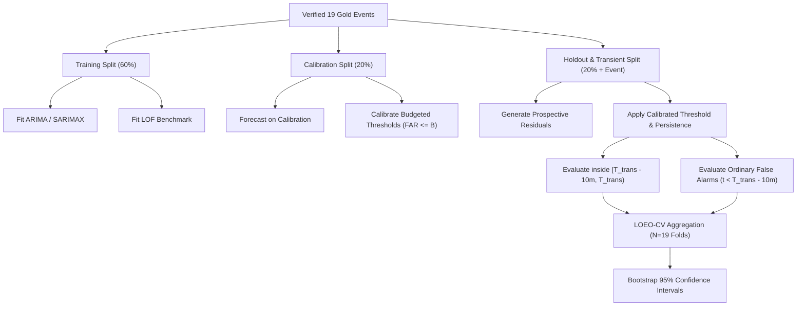

# OILGUARD-AC: Experiment Plan and Technical Roadmap

**Project:** OILGUARD — Forecasting-Based Early Warning of Abnormal Events in Oil Wells  
**Experiment Campaign:** OILGUARD-AC (Alarm-Constrained, Multisensor Early Warning)  
**Date:** October 2026  

---

## 1. Objectives

This experiment plan defines the technical implementation and empirical validation for **OILGUARD-AC**. The goal is to rigorously test whether multisensor residual integration and alarm-constrained threshold calibration improve early warning performance on the Petrobras 3W Class 2 benchmark under leak-free Leave-One-Event-Out Cross-Validation (LOEO-CV).

---

## 2. Experimental Hypotheses

- **H1 (Multisensor Benefit):** Incorporating normalized downhole temperature deviations ($z_T$) alongside pressure forecast residuals ($z_P$) increases early detection rates or advance lead times without inflating false alarm rates.
- **H2 (Budgeted Calibration Robustness):** Calibrating detection thresholds on normal operating data to meet an operational false-alarm budget ($B_{\text{FAR}} \le 1.0\text{ or } 2.0\text{ FA/hr}$) reliably bounds realized false alarms on unseen holdout well events.
- **H3 (Forecasting vs. Non-Forecasting):** Rolling time-series forecasting residuals achieve longer lead times and higher warning precision than non-forecasting density-based anomaly detectors (Local Outlier Factor, LOF) when both are subject to the same false alarm constraints.

---

## 3. Methodological Details

### 3.1 Multisensor Composite Score Formulation
For time step $t$ in event $k$:
1. Rolling 1-step-ahead pressure forecast residual: $e_P(t) = y_P(t) - \hat{y}_P(t)$ (using ARIMA or SARIMAX).
2. Standardized pressure residual:
   $$z_{P, t} = \frac{|e_{P, t}|}{\hat{\sigma}_{\text{calib}, e_P}}$$
3. Standardized temperature deviation from calibration mean:
   $$z_{T, t} = \frac{|T_t - \mu_{\text{calib}, T}|}{\hat{\sigma}_{\text{calib}, T}}$$
4. Weighted composite anomaly score:
   $$S_t = \sqrt{w_P \cdot z_{P, t}^2 + (1 - w_P) \cdot z_{T, t}^2}$$
   We evaluate $w_P \in \{0.5, 0.7, 0.85, 1.0\}$ (where $w_P = 1.0$ is the pure univariate pressure residual baseline).

### 3.2 False-Alarm-Budgeted Threshold Calibration
Given normal calibration data of duration $H_{\text{calib}}$ hours and a target budget $B_{\text{FAR}}$ (e.g., 1.0 FA/hr):
- Allowed normal false alarms during calibration: $K_{\text{allowed}} = \lfloor B_{\text{FAR}} \cdot H_{\text{calib}} \rfloor$.
- We select threshold $\tau$ such that the number of persistent alarm triggers during the calibration split does not exceed $K_{\text{allowed}}$.
- We evaluate budgets: $B_{\text{FAR}} \in \{0.5, 1.0, 2.0, 3.0\}\text{ alarms/hour}$.

### 3.3 Established Non-Forecasting Benchmark: Local Outlier Factor (LOF)
As recommended by Fernandes et al. (2023):
- We deploy `sklearn.neighbors.LocalOutlierFactor(novelty=True, n_neighbors=20, metric='minkowski')`.
- Fitted strictly on normalized calibration data (`[P-TPT, T-TPT]`).
- Outlier score: negative decision function shifted to positive anomaly score.
- Evaluated under the identical alarm-budgeted threshold calibration and early warning evaluation rules.

---

## 4. Experiment Workflow & Deliverables

### Planned Metrics & Output Tables:
1. `results/metrics/oilguard_ac_multisensor_ablation.csv` — Weights $w_P \in [0.5, 1.0]$ comparison.
2. `results/metrics/oilguard_ac_budget_calibration.csv` — Budgets $B \in [0.5, 3.0]$ vs realized holdout FAR.
3. `results/metrics/oilguard_ac_benchmark_comparison.csv` — Head-to-head comparison: OILGUARD-AC vs ARIMA vs SARIMAX vs Naive vs LOF.
4. `results/metrics/oilguard_ac_loeo_cv_summary.csv` — Leak-free Leave-One-Event-Out cross-validation summary with 95% bootstrap confidence intervals.
5. `results/figures/oilguard_ac_tradeoff.png` — Visual trade-off between realized FAR, detection rate, and lead time across all models.

---

## 5. Execution Safeguards

1. **Strict Data Hygiene:** No test/holdout observations ever enter model fitting, scaling, or threshold calibration.
2. **Deterministic Reproducibility:** Fixed random seeds (`random_state=42`) for LOF and bootstrapping.
3. **Preservation of Existing Outputs:** All original pipeline and optimization outputs remain untouched; new research artifacts are generated with clear `oilguard_ac_*` identifiers.
